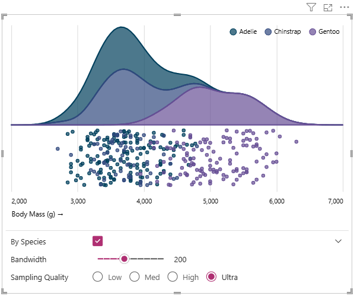
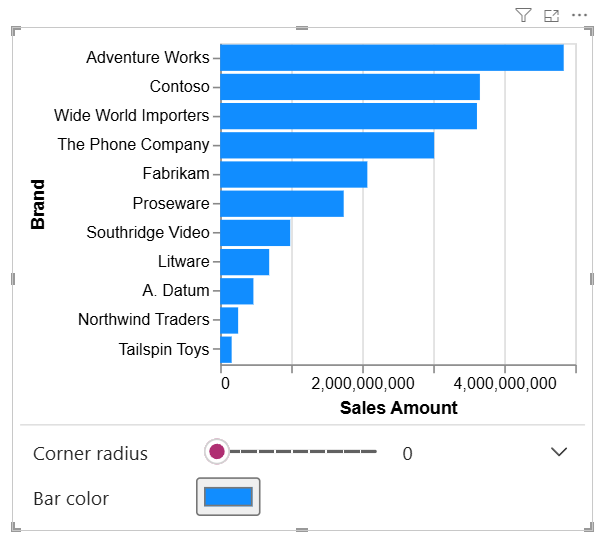
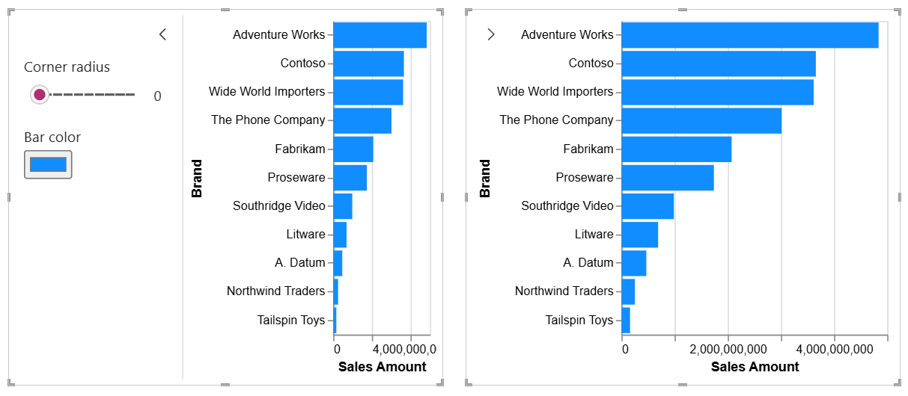
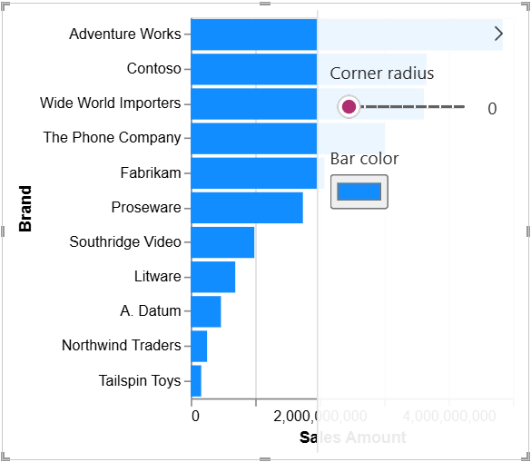
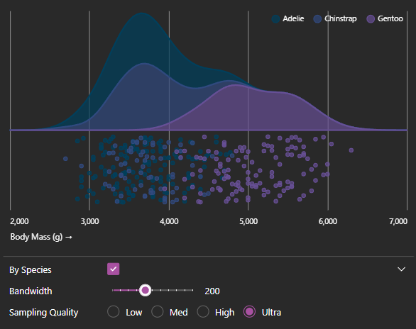

import EarlyAccessWarning from "@site/src/components/EarlyAccessWarning.mdx";

# Input Bindings

<EarlyAccessWarning />

In Vega, a [signal](https://vega.github.io/vega/docs/signals/#bind) can be bound to an input element, such as a slider or a dropdown, through its `bind` property. Vega-Lite does the same for [parameters](https://vega.github.io/vega-lite/docs/bind.html#input-element-binding). Changing the input changes the signal's value, and anything in your spec that uses that signal updates with it.

Before 2.1, these inputs were drawn by Vega as a plain HTML form below the chart, which is the default method. It couldn't be styled or positioned, and the chart didn't know it was there, so specs often had to subtract room for it by hand.

Deneb now draws these controls itself, in a **bindings pane** beside the chart. The controls match the look of the rest of Power BI; each signal gets a row of its own, and the chart is sized to the remaining space.



## A Simple Example

This Vega-Lite spec binds two parameters: a slider for the bars' corner radius and a color picker for their fill.

```json
{
  "data": { "name": "dataset" },
  "params": [
    {
      "name": "radius",
      "value": 0,
      "bind": {
        "input": "range",
        "min": 0,
        "max": 10,
        "step": 1,
        "name": "Corner radius"
      }
    },
    {
      "name": "barColor",
      "value": "#118dff",
      "bind": { "input": "color", "name": "Bar color" }
    }
  ],
  "mark": {
    "type": "bar",
    "cornerRadiusEnd": { "expr": "radius" },
    "color": { "expr": "barColor" }
  },
  "encoding": {
    "y": { "field": "Brand", "type": "nominal", "sort": "-x" },
    "x": { "field": "Sales Amount", "type": "quantitative" }
  }
}
```

In Deneb, the controls appear in a pane below the chart:



There's nothing Deneb-specific in this spec. Any spec with a `bind` that works in the Vega or Vega-Lite editor gets a pane in Deneb, with no opt-in.

## How Controls Are Rendered

Each bound signal gets one control, chosen by `bind.input`:

| `bind.input`   | Control                        | Value written to the signal   |
| -------------- | ------------------------------ | ----------------------------- |
| `range`        | Slider, with its value shown   | Number                        |
| `checkbox`     | Checkbox                       | `true` or `false`             |
| `radio`        | Radio group                    | The chosen option, as defined |
| `select`       | Dropdown                       | The chosen option, as defined |
| `color`        | The browser's own color picker | Six-digit hex string          |
| Any other type | Text input of that type        | String                        |

The controls follow the rules Vega uses for its own form, so a spec behaves the same in Deneb as it does in the Vega editor:

- A control is labeled with `bind.name`, or with the signal's name if there isn't one.
- `bind.labels` gives display names to the options of a `select` or `radio`. The options themselves keep their JSON type, including `null`.
- A `range` with no `min`, `max` or `step` uses Vega's defaults, which are worked out from the value the signal is defined with.
- Input types other than `range` and `checkbox` write strings, including `number`. Vega does the same, so convert the value in an expression if you need a number (for example, `toNumber(mySignal)`).

A few things differ from Vega on purpose:

- `select` uses the browser's native dropdown, so a long list of options isn't cut off by the edge of the visual.
- For other input types, Deneb only passes on `placeholder`, `autocomplete`, `min`, `max`, `step`, `minlength`, `maxlength` and `pattern` from the `bind` object. An input type the control doesn't support renders as a text input.
- A binding with an `element` and no `input` is ignored. It targets an element on the page, but there isn't one in the visual to target.

## Layout

By default, the pane sits below the chart, and the chart is sized to the space above it. A spec with no bound signals gets no pane, and its layout is exactly as before.

- **Edge.** The pane can be placed on any edge of the visual (see [`orient`](#settings)). On the top or bottom, each label sits beside its control. On the left or right, each label sits above its control.
- **Size.** The pane takes up to 40% of the visual by default: of its height on the top or bottom, or of its width on the left or right. If the controls need more room than that, the pane scrolls and the chart keeps the rest. You can change the share with [`maxSize`](#settings).
- **Floating.** With [`float`](#settings) on, the pane sits over the chart on its edge instead of beside it, and the chart keeps the whole visual.
- **Collapsing.** A toggle in the pane hides it and gives the chart the whole visual. When collapsed, a small button stays in the corner of the chart nearest the pane's edge, so a report reader can bring the controls back.

For example, here's a pane on the left edge, expanded and then collapsed:



And here's a pane floating over the right edge, with a partly transparent [`background`](#settings) so the chart shows through:



## Configuring the Pane

You can place and style the pane with a `deneb.bindings` key. Add it to the [Config editor](visual-editor#config-editor-pane), or to the `config` in your spec:

```json
{
  "deneb": {
    "bindings": {
      "orient": "right",
      "maxSize": 0.3,
      "accentColor": "#118dff"
    }
  }
}
```

Much like existing `config` and `spec` parsing, anything at a `spec` level will override the corresponding `config` object if they exist in both editors.

The Config editor completes the `deneb` key and its settings as you type, shows what each setting does on hover, and underlines invalid values. The Spec editor offers the same inside a spec's own `config`.

### Settings

| Setting       | Values                                   | Default                                      |
| ------------- | ---------------------------------------- | -------------------------------------------- |
| `orient`      | `"top"`, `"bottom"`, `"left"`, `"right"` | `"bottom"`                                   |
| `float`       | `true` or `false`                        | `false`                                      |
| `collapsible` | `true` or `false`                        | `true`                                       |
| `collapsed`   | `true` or `false`                        | `false`                                      |
| `maxSize`     | A number above `0`, up to `1`            | `0.4`                                        |
| `fontFamily`  | Font names, separated by commas          | The theme's font                             |
| `fontSize`    | A number from `1` to `100`, in px        | The theme's size                             |
| `color`       | A CSS color                              | The theme's text color                       |
| `accentColor` | A CSS color                              | The theme's accent color                     |
| `background`  | A CSS color                              | Transparent, or white when `float` is `true` |
| `borderColor` | A CSS color                              | The theme's line color                       |

- `collapsible` controls whether the toggle is shown. `collapsed` sets whether the pane starts collapsed.
- `color` applies to text drawn on the pane, such as labels. Dropdowns and text inputs keep their own light background and text, so they stay readable if you set a light `color` for a dark report page.
- A CSS color can be a hex value (such as `#118dff`), a color name (such as `steelblue`), or a single color function with plain arguments (such as `rgb(17 141 255)`).
- If a value is invalid, Deneb uses that setting's default instead. If a key isn't recognized, Deneb ignores it. Both add a warning to the [Logs pane](visual-editor#logs-pane), and neither is shown to report readers.

### Example: Styling for a Dark Page

Here's a pane styled to match a chart on a dark report page:



This uses the following config:

```json
{
  "deneb": {
    "bindings": {
      "color": "white",
      "background": "#292929",
      "accentColor": "#a851a1",
      "borderColor": "#525252",
      "maxSize": 0.5
    }
  }
}
```

The outlines of the unselected radio buttons stay dim on a dark background. This is one of the [known limitations](#known-limitations).

## Bound Values and Re-rendering

When a report reader changes a control, Deneb keeps that value while the visual stays on the page, including when:

- the visual is resized.
- its data updates, for example from slicing or cross-filtering, whether or not [continuous view](dataset#continuous-view-data-patching) is on.

Before 2.1, both of these set the value back to the one in the spec, unless continuous view was patching the data.

Values go back to the ones in the spec when the visual starts again from scratch, for example, when a report reader leaves the page and comes back, or you start a new spec. If you change a bound signal's definition (including its event handlers), its value also resets to the new definition.

## Updating Existing Specs

The bindings pane is always on, so existing specs with input bindings will pick it up when the visual is updated to 2.1.

- If your spec reserved room for Vega's form, for example by reducing its `height` by a fixed amount, you'll see an empty band until you remove that workaround.
- Any binding that uses `element` without `input` is no longer rendered.

## Known Limitations

- If a spec compiles but its view fails to start, the pane still shows, above a blank chart.
- When a control changes how much room the chart needs (for example, by filtering it down to fewer bars), Deneb re-fits the chart to the visual. A selection made in the chart itself isn't re-fitted, which is Vega's default. If that's a problem for your spec, set [`autosize`](https://vega.github.io/vega/docs/specification/#autosize-properties) `resize` to `true`.
- A chart using Vega's default `pad` autosize will grow or shrink when a control changes the room it needs.
- With a light `color` on a dark `background`, the outlines of unchecked radio buttons and the slider's rail stay dim.
